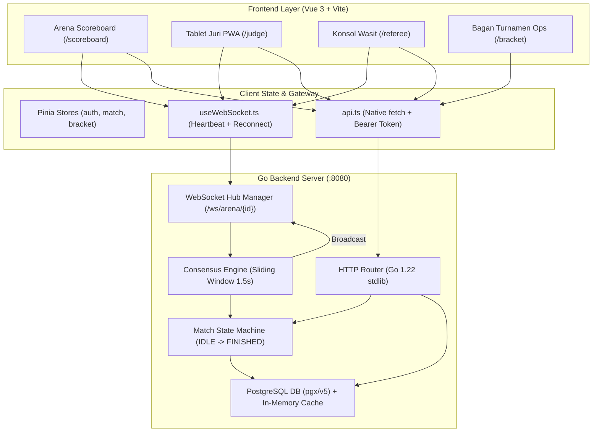

# Rencana Integrasi Menyeluruh: Frontend Vue 3 ke Go Backend Digital Scoring

Dokumen ini adalah cetak biru teknis (technical integration blueprint) untuk menghubungkan seluruh tampilan antarmuka **Frontend Vue 3** (`apps/web`) dengan **Go Backend & WebSocket Hub** (`internal/api`, `internal/hub`, PostgreSQL) secara end-to-end.

---

## 1. Arsitektur Komunikasi & Aliran Data

Sistem Digital Scoring Pencak Silat mengimplementasikan pola arsitektur **Hybrid REST API & Real-Time WebSocket**:



### 1.1 Protokol & Transport
1. **HTTP REST API (`/api/v1/*`)**:
   - Digunakan untuk: Autentikasi, initial snapshot data, manajemen turnamen/kategori/atlet, generate bagan, load match ke arena, dan export laporan PDF/CSV.
   - Format: JSON standard `{"success": true, "data": ...}` / `{"success": false, "error": {"code": "...", "message": "..."}}`.
2. **WebSocket Engine (`/ws/arena/{arena_id}`)**:
   - Digunakan untuk: Real-time scoring submissions, sinkronisasi timer (countdown millisecond), voting consensus juri, alarm gong arena, dan perubahan state pertandingan.
   - Autentikasi WS: Query string token `?token=<JWT>` saat HTTP upgrade handshake (menyesuaikan batas native browser WebSocket API). Scoreboard publik terhubung tanpa token.

---

## 2. Manajemen Autentikasi & Otorisasi (RBAC)

Backend mengadopsi 2 metode login terpisah berdasarkan perangkat:

| Peran (Role) | Metode Login | Endpoint | Payload Request | Data JWT Claims |
|---|---|---|---|---|
| **Juri 1 - 5** | 6-Digit PIN | `POST /api/v1/auth/judge-login` | `{ competition_id, arena_id, pin }` | `role: "judge"`, `seat_number: 1..5`, `arena_id`, `competition_id` |
| **Wasit Gelanggang** | Email / Sandi atau Wasit PIN | `POST /api/v1/auth/login` | `{ email, password }` | `role: "wasit"`, `user_id` |
| **Admin / Dewan / Delegasi** | Email & Password | `POST /api/v1/auth/login` | `{ email, password }` | `role: "admin"` / `"dewan"`, `user_id` |
| **Scoreboard TV** | Anonim (Public Read) | Tidak perlu token | N/A | Public Spectator Mode |

### 2.1 Desain Pinia Auth Store (`src/stores/auth.ts`)
```typescript
export interface AuthUser {
  token: string
  role: 'admin' | 'dewan' | 'wasit' | 'judge' | 'public'
  seatNumber?: number
  arenaId?: string
  competitionId?: string
  name?: string
}

export const useAuthStore = defineStore('auth', () => {
  const user = ref<AuthUser | null>(loadSession())

  const isAuthenticated = computed(() => !!user.value?.token)
  const isJudge = computed(() => user.value?.role === 'judge')
  const isReferee = computed(() => user.value?.role === 'wasit' || user.value?.role === 'admin')

  function setSession(authData: AuthUser) {
    user.value = authData
    sessionStorage.setItem('ds_auth', JSON.stringify(authData))
  }

  function clearSession() {
    user.value = null
    sessionStorage.removeItem('ds_auth')
  }

  return { user, isAuthenticated, isJudge, isReferee, setSession, clearSession }
})
```

---

## 3. Integrasi Screen-by-Screen (Modul per Modul)

### 3.1 Modul 01: Arena Scoreboard (`/scoreboard/:arena_id?`)
*Target Layar: Tampilan LED TV Stadium 16:9 fullscreen (`01_arena_scoreboard.png`)*

1. **Initial Hydration (HTTP Snapshot)**:
   - Request: `GET /api/v1/live/scoreboard/{arena_id}`
   - Respons data memuat: Data pertandingan aktif, atlet merah/biru, skor akumulasi babak 1-3, sanksi pelanggaran (teguran, peringatan), sisa waktu babak, dan status babak saat ini (`ROUND_1`, `ROUND_2`, `ROUND_3`, `BREAK_1`, `BREAK_2`, `FINISHED`).
2. **WebSocket Subscription**:
   - Koneksi: `new WebSocket("/ws/arena/" + arena_id)` (tanpa token).
3. **Pesan Real-Time yang Ditangani**:
   - `score_confirmed`: Menambahkan poin atlet (Merah/Biru), memperbarui total skor, dan memicu animasi toast poin floating (+1 PUKULAN, +2 TENDANGAN, +3 JATUHAN).
   - `penalty`: Memperbarui indikator kartu sanksi (Teguran 1-2, Peringatan 1-2) dan mendiskon nilai.
   - `timer_sync`: Memanggil `timer.sync(remaining_ms, is_running)` agar jam sinkron persis dengan backend ticker.
   - `state_change`: Mengubah status babak atau memicu modal perayaan pemenang saat state beralih ke `FINISHED`.

---

### 3.2 Modul 02: Tablet Juri PWA (`/judge`)
*Target Layar: Tablet sentuh ergonomis landscape (`02_judge_tablet_pwa.png`)*

1. **Alur Masuk (PIN Onboarding)**:
   - Menampilkan modal input 6-digit PIN saat pertama kali dibuka.
   - Memanggil `POST /api/v1/auth/judge-login`.
   - Mengambil `token` dan `seat_number` (Juri 1, 2, atau 3).
2. **WebSocket Scoring Pipeline**:
   - Koneksi: `new WebSocket("/ws/arena/" + arena_id + "?token=" + token)`.
3. **Payload Kirim Poin (Anti-Bias & Idempotensi)**:
   - Juri menekan tombol (misal: Pukulan Merah +1):
     ```json
     {
       "action": "score",
       "target": "red",
       "score_type": "pukulan",
       "points": 1,
       "idempotency_key": "c2b64789-7243-41bb-98bc-ffca9a5276e1"
     }
     ```
   - Tombol **BATAL** (Undo koreksi dalam 2 detik):
     ```json
     {
       "action": "undo",
       "idempotency_key": "c2b64789-7243-41bb-98bc-ffca9a5276e1"
     }
     ```
4. **Kepatuhan Regulasi IPSI/PERSILAT (Pasal 28)**:
   - Nilai kumulatif disembunyikan dari tablet juri agar penilaian tetap objektif dan independen.
   - Tablet juri hanya menampilkan tombol aksi dan indikator feedback getar haptik lokal (50ms).

---

### 3.3 Modul 03: Konsol Wasit & Meja Pengawas (`/referee`)
*Target Layar: Komando Wasit Gelanggang (`03_referee_console.png`)*

1. **Kendali Pertandingan (Dual-Channel: REST + WS)**:
   - Setiap tombol aksi kontrol wasit memicu REST API (untuk audit log terverifikasi) dan menyiarkan sinyal WebSocket untuk sinkronisasi instan:
     - **Mulai / Lanjut**: `POST /api/v1/competitions/{comp_id}/matches/{id}/start` & WS `action: "start"`.
     - **Jeda (Pause)**: `POST /api/v1/competitions/{comp_id}/matches/{id}/pause` & WS `action: "pause"`.
     - **Selesaikan Laga**: `POST /api/v1/competitions/{comp_id}/matches/{id}/finish` & WS `action: "finish"`.
     - **Diskualifikasi**: `POST /api/v1/competitions/{comp_id}/matches/{id}/cancel` & WS `action: "cancel"`.
2. **Penalti & Sanksi Berjenjang**:
   - Tombol Teguran 1-2, Peringatan 1-2 mengirim pesan WS:
     ```json
     {
       "action": "penalty",
       "target": "red",
       "level": 1
     }
     ```
3. **Pemantau Konsensus Juri (Live Telemetry)**:
   - Mendengarkan event WS `consensus_status`:
     ```json
     {
       "action": "consensus_status",
       "window_ms": 1500,
       "judges": [
         { "seat": 1, "active": true, "last_vote": "red_pukulan" },
         { "seat": 2, "active": true, "last_vote": "red_pukulan" },
         { "seat": 3, "active": true, "last_vote": "none" }
       ],
       "consensus_reached": true
     }
     ```
   - Memperbarui badge indikator juri pada panel kiri bawah konsol secara real-time.

---

### 3.4 Modul 04: Bagan Turnamen & Komando Operasi (`/bracket`)
*Target Layar: Ops Dashboard & Bracket Tree (`04_tournament_bracket_ops.png`)*

1. **Pengambilan Data Pohon Bagan (Cached S3-FIFO)**:
   - Endpoint: `GET /api/v1/competitions/{comp_id}/brackets?weight_class=A&gender=male`
   - Data pohon memetakan setiap slot pertandingan:
     - `round`: 1 (16 Besar), 2 (Perempat Final), 3 (Semifinal), 4 (Final).
     - `athlete_red`, `athlete_blue`, `winner_id`, `score_red`, `score_blue`, `arena_id`.
2. **Kualifikasi Timbang Badan**:
   - Endpoint: `GET /api/v1/competitions/{comp_id}/participants`
   - Menghitung rasio `verified_count / total_count` untuk badge `16/16 ATLET OK`.
3. **Pengacakan Bagan (Generate Draw)**:
   - Endpoint: `POST /api/v1/competitions/{comp_id}/brackets/generate`
   - Request: `{ "weight_class": "A", "gender": "male", "participant_ids": [...] }`.
   - Mengembalikan susunan bagan teracak lengkap dengan legalitas hash: `#IPSI-2025-CL-A-xxxx`.
4. **Dispatcher: Muat ke Gelanggang (`load-arena`)**:
   - Tombol **"MUAT KE MAT 1"** atau **"Kirim ke Gelanggang 1"**:
   - Memanggil `POST /api/v1/competitions/{comp_id}/matches/{match_id}/load-arena`:
     ```json
     {
       "arena_id": "c48ee982-dccc-4f27-8ba4-f9672d1827bb"
     }
     ```
   - Backend memicu state transition `IDLE -> READY` pada arena tersebut dan menyiarkan pesan ke Scoreboard & Wasit Gelanggang.

---

## 4. Penanganan Offline, Jaringan Lemah & Idempotensi

Pertandingan silat sering kali diadakan di GOR olahraga dengan interferensi sinyal Wi-Fi tinggi. Frontend menerapkan strategi keandalan tingkat tinggi:

1. **Idempotency Key (UUID v4)**:
   - Setiap klik penilaian juri menghasilkan `idempotency_key` di sisi klien (`apps/web/src/lib/uuid.ts`).
   - Jika sinyal sempat terputus dan juri menekan ulang, backend Go akan mendeteksi key duplikat dalam sliding window 1.5 detik dan mengabaikan vote ganda.
2. **Exponential Backoff Reconnect**:
   - `useWebSocket.ts` memantau putusnya koneksi (`onclose`, `onerror`).
   - Reconnect dilakukan otomatis dengan interval bertingkat: 1s → 2s → 4s → 8s (maks 15s) tanpa me-refresh browser.
3. **Drift-Compensated Chronometer**:
   - `useTimer.ts` menggunakan kalkulasi `performance.now()` dengan interval tick 50ms untuk menghindari timer drifting akibat background tab throttle di browser.

---

## 5. Konfigurasi Lingkungan & Proxy (Vite)

Untuk mencegah error CORS dan masalah port lokal saat development:

### 5.1 Environment Variables (`apps/web/.env`)
```bash
VITE_API_BASE_URL=http://localhost:8080
VITE_WS_BASE_URL=ws://localhost:8080
```

### 5.2 Konfigurasi Vite Reverse Proxy (`apps/web/vite.config.ts`)
```typescript
export default defineConfig({
  server: {
    port: 5173,
    proxy: {
      '/api': {
        target: 'http://localhost:8080',
        changeOrigin: true,
      },
      '/ws': {
        target: 'ws://localhost:8080',
        ws: true,
      },
    },
  },
})
```

---

## 6. Rencana Tahapan Eksekusi (Implementation Milestones)

| Fase | Durasi Estimasi | Lingkup Pekerjaan | Kriteria Sukses |
|---|---|---|---|
| **Fase 1** | Hari 1 | **Core Client Services**: Refactor `api.ts` dengan interceptor token, implementasi Pinia `useAuthStore`, dan setup proxy Vite. | Request REST menyertakan Bearer Token otomatis jika ada. |
| **Fase 2** | Hari 1-2 | **Autentikasi & Sesi Juri**: Modal input PIN juri di `/judge`, validasi ke `/api/v1/auth/judge-login`, simpan `seat_number` dan arena. | Juri login berhasil, token tersimpan di session storage. |
| **Fase 3** | Hari 2-3 | **Pipeline Real-Time Scoreboard**: Sinkronisasi `/scoreboard/:arena_id` ke snapshot REST `/api/v1/live/scoreboard/{arena_id}` dan event stream WS. | Skor dan timer live sinkron dengan Go server. |
| **Fase 4** | Hari 3-4 | **Voting Juri & Konsensus**: Hubungkan tombol scoring `/judge` ke WS backend, uji konsensus multi-juri (minimal 2 juri menekan dalam 1.5s). | Poin masuk ke scoreboard saat 2 juri sepakat. |
| **Fase 5** | Hari 4-5 | **Kontrol Konsol Wasit**: Hubungkan tombol timer, jeda, diskualifikasi, dan sanksi wasit `/referee` ke endpoint match lifecycle backend. | Wasit bisa mengendalikan jalannya ronde dan timer. |
| **Fase 6** | Hari 5-6 | **Bagan Turnamen Ops**: Hubungkan `/bracket` ke endpoint generate bagan, filter kategori, timbang badan, dan tombol `load-arena`. | Klik "Kirim ke Gelanggang" langsung me-load atlet ke arena 1. |
| **Fase 7** | Hari 7 | **End-to-End Simulation Testing**: Simulasi simultan 1 Turnamen (16 Atlet), 1 Wasit, 3 Juri, 1 Scoreboard Display. | Seluruh alur pertandingan dari bagan hingga penentuan juara berjalan mulus tanpa error. |
