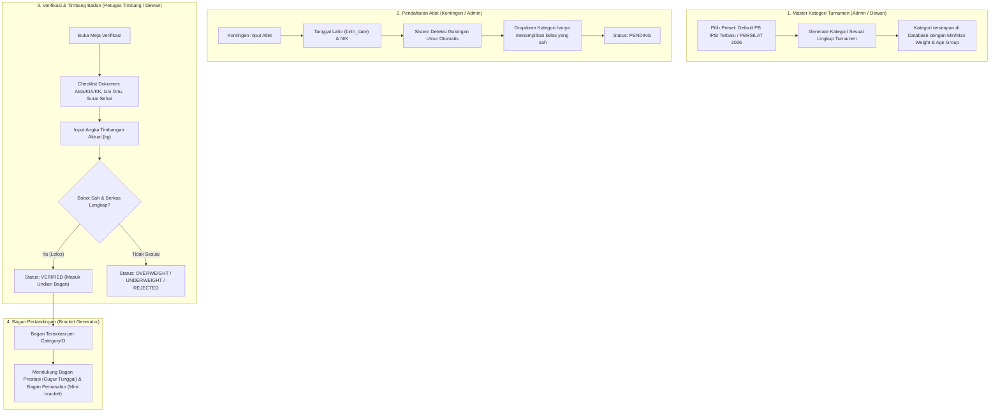

# 📋 Rencana Desain & Arsitektur: Kategori & Pendaftaran Resmi PB IPSI Terbaru (dengan Fleksibilitas PERSILAT 2026)

Rencana ini disusun dengan fokus utama pada **Regulasi Resmi Pertandingan PB IPSI Terbaru (Pengurus Besar Ikatan Pencak Silat Indonesia / Hasil Munas & Pokja Penyempurnaan Regulasi)** untuk mengakomodasi kejuaraan tingkat **Kabupaten, Daerah (Kejurkab/Kejurda/Popda), maupun Kejuaraan Terbuka (Open Tournament)** di Indonesia, serta tetap menyediakan kompatibilitas penuh dengan regulasi internasional **PERSILAT 2026**.

---

## 1. Analisis Regulasi Resmi PB IPSI Terbaru (Fokus Domestik & Daerah)

### A. Penggolongan Umur Resmi PB IPSI
Penggolongan usia berpedoman pada usia atlet saat hari pertama kejuaraan dibuka (*cut-off date*) atau tahun berjalan, dibuktikan dengan dokumen resmi kependudukan/pendidikan:

1. **Pra Usia Dini**: Usia $\le$ 5 tahun *(Kategori Balita / TK - Festival / Pemasalan)*
2. **Usia Dini 1**: Usia > 5 tahun s.d. 8 tahun *(Tingkat TK B - SD Kelas Awal / Pemasalan)*
3. **Usia Dini 2**: Usia > 8 tahun s.d. 11 tahun *(Tingkat SD Kelas 3–6)*
4. **Pra-Remaja**: Usia > 11 tahun s.d. 14 tahun *(Tingkat SMP)*
5. **Remaja**: Usia > 14 tahun s.d. 17 tahun *(Tingkat SMA / Sederajat)*
6. **Dewasa**: Usia > 17 tahun s.d. 35 tahun *(Tingkat Mahasiswa / Umum / Standar KONI, Porprov, PON)*
7. **Master A**: Usia > 35 tahun s.d. 45 tahun
8. **Master B**: Usia > 45 tahun ke atas

> **Prinsip Keabsahan Identitas & Perlindungan Atlet di Bawah Umur (IPSI):**
> - Atlet di bawah 17 tahun yang belum memiliki e-KTP wajib menggunakan **NIK** yang tercantum pada **Kartu Keluarga (KK)**, **Kartu Identitas Anak (KIA)**, atau **Akta Kelahiran**.
> - Untuk kejuaraan resmi daerah, verifikasi screening mewajibkan kelengkapan:
>   1. **Akta Kelahiran / KIA / Kartu Keluarga** (validasi tanggal lahir & NIK).
>   2. **Ijazah / Rapor Terakhir** (memastikan jenjang sekolah SD/SMP/SMA).
>   3. **Surat Izin Orang Tua / Wali bermaterai** (aspek perlindungan hukum anak).
>   4. **Surat Keterangan Sehat dari Dokter** (keabsahan medis sebelum timbang badan).

---

### B. Matriks Kelas Berat Badan Tanding Resmi

#### 1. Usia Dini 1 & 2 (Tingkat SD)
- **Rentang Bobot**:
  - Kelas A (26–28 kg), B (>28–30 kg), C (>30–32 kg), D (>32–34 kg), E (>34–36 kg)
  - Kelas F (>36–38 kg), G (>38–40 kg), H (>40–42 kg), I (>42–44 kg), J (>44–46 kg)
  - Kelas K (>46–48 kg), L (>48–50 kg), M (>50–52 kg), N (>52–54 kg), O (>54–56 kg)
  - Kelas P (>56–58 kg), Q (>58–60 kg), R (>60–62 kg), S (>62–64 kg)
  - **Kelas OPEN**: >64 kg s/d 68 kg
  *(Catatan: Untuk Pra Usia Dini & Usia Dini 1 pada event daerah, panitia dapat menggunakan kelas bagan mini / selisih max 2 kg)*.

#### 2. Pra-Remaja (Tingkat SMP: > 11–14 Tahun)
- **Rentang Bobot**:
  - Kelas A (30–33 kg), B (>33–36 kg), C (>36–39 kg), D (>39–42 kg), E (>42–45 kg)
  - Kelas F (>45–48 kg), G (>48–51 kg), H (>51–54 kg), I (>54–57 kg), J (>57–60 kg)
  - Kelas K (>60–63 kg), L (>63–66 kg), M (>66–69 kg), N (>69–72 kg), O (>72–75 kg)
  - Kelas P (>75–78 kg)
  - **Kelas OPEN**: >78 kg s/d 84 kg

#### 3. Remaja (Tingkat SMA: > 14–17 Tahun)
- **Putra**: Under 39 kg, Kelas A (39–43 kg), B (>43–47 kg), C (>47–51 kg), D (>51–55 kg), E (>55–59 kg), F (>59–63 kg), G (>63–67 kg), H (>67–71 kg), I (>71–75 kg), J (>75–79 kg), K (>79–83 kg), L (>83–87 kg), **OPEN 1** (>87–100 kg), **OPEN 2** (>100 kg).
- **Putri**: Under 39 kg, Kelas A (39–43 kg), B (>43–47 kg), C (>47–51 kg), D (>51–55 kg), E (>55–59 kg), F (>59–63 kg), G (>63–67 kg), H (>67–71 kg), I (>71–75 kg), J (>75–79 kg), **OPEN 1** (>79–92 kg), **OPEN 2** (>92 kg).

#### 4. Dewasa (Mahasiswa / Umum: > 17–35 Tahun di IPSI)
- **Putra**: Under 45 kg, Kelas A (45–50 kg), B (>50–55 kg), C (>55–60 kg), D (>60–65 kg), E (>65–70 kg), F (>70–75 kg), G (>75–80 kg), H (>80–85 kg), I (>85–90 kg), J (>90–95 kg), **OPEN 1** (>95–110 kg), **OPEN 2** (>110 kg).
- **Putri**: Under 45 kg, Kelas A (45–50 kg), B (>50–55 kg), C (>55–60 kg), D (>60–65 kg), E (>65–70 kg), F (>70–75 kg), G (>75–80 kg), H (>80–85 kg), **OPEN 1** (>85–100 kg), **OPEN 2** (>100 kg).

---

### C. Ketentuan Timbang Badan Resmi (Weigh-in)
- **TIDAK ADA TOLERANSI BERAT BADAN (0 kg tolerance)**: Kelebihan maupun kekurangan berat badan walau 0.1 kg berakibat sanksi **Diskualifikasi**.
- **Waktu Penimbangan**: Pagi hari sebelum sesi pertandingan dimulai, khusus untuk pesilat yang bertanding pada hari tersebut.
- **Tata Cara**: Pakaian silat kering tanpa pelindung (tanpa body protector, pelindung kemaluan, dan pelindung sendi).
- **Pencatatan**: Ditandatangani bersama oleh petugas timbang panitia dan ofisial kontingen.

---

## 2. Alur Arsitektur Sistem Baru

---

## 3. Rencana Komponen yang Perlu Dibuat & Diperbarui

### A. Skema Database (PostgreSQL Migration)

1. **Tabel `categories`**:
   - `age_group VARCHAR(50) DEFAULT 'dewasa'` *(pilihan: `pra_usia_dini`, `usia_dini_1`, `usia_dini_2`, `pra_remaja`, `remaja`, `dewasa`, `master_a`, `master_b`)*.
   - `preset_standard VARCHAR(50) DEFAULT 'ipsi'` *(opsi: `ipsi` atau `persilat_2026`)*.
   - `min_weight NUMERIC(5,2)` *(bobot minimal kg)*.
   - `max_weight NUMERIC(5,2)` *(bobot maksimal kg)*.
   - `bracket_mode VARCHAR(30) DEFAULT 'single_elimination'` *(opsi: `single_elimination` atau `pemasalan_4`)*.

2. **Tabel `athletes`**:
   - `birth_date DATE NOT NULL` *(tanggal lahir lengkap untuk kalkulasi akurat per tanggal hari-H atau tahun kalender)*.
   - `nik VARCHAR(50)` *(NIK dari KK/KIA/Akta Kelahiran atau Paspor)*.

3. **Tabel `participants`**:
   - `category_id UUID REFERENCES categories(id)` *(menghubungkan atlet ke kategori spesifik)*.
   - `actual_weight NUMERIC(5,2)` *(hasil timbang badan aktual)*.
   - `docs_verified JSONB DEFAULT '{}'` *(checklist verifikasi dokumen: akta/KIA/KK, surat izin orang tua, surat keterangan sehat dokter)*.

4. **Tabel `bracket_slots`**:
   - `category_id UUID REFERENCES categories(id)` *(memastikan bagan terisolasi per kategori)*.

---

### B. Backend Services (Go Core)

1. **`internal/domain/models.go`**:
   - Update model `Category`, `Athlete`, `Participant`, dan `BracketSlot`.
2. **`internal/store/`**:
   - Tambahkan pembacaan/penyimpanan kolom baru pada repository `category.go`, `athlete.go`, dan `bracket.go`.
3. **`internal/service/athlete_service.go` & `handler/athlete.go`**:
   - Validasi pendaftaran atlet terhadap umur minimum dan maksimum golongan.
   - Endpoint `VerifyParticipant` mencatat `actual_weight`, status dokumen keabsahan (`docs_verified`), dan memvalidasi apakah masuk di rentang min–max kelas.
4. **`internal/service/bracket_service.go` & `handler/bracket.go`**:
   - Mengelompokkan slot bagan berdasarkan `category_id`.
   - Mendukung pembuatan bagan eliminasi standar dan bagan pemasalan (mini-bracket 4 peserta) untuk kategori usia dini.

---

### C. Frontend Presets & UI (Vue / TypeScript)

1. **`category.schema.ts`**:
   - Mendukung preset ganda dengan **Default: Preset PB IPSI Terbaru**:
     - **Preset PB IPSI Terbaru (Default - Tingkat Daerah / Nasional)**:
       - Pra Usia Dini ($\le$ 5 th)
       - Usia Dini 1 (> 5 – 8 th / SD Kelas Awal)
       - Usia Dini 2 (> 8 – 11 th / SD Kelas Lanjutan)
       - Pra-Remaja (> 11 – 14 th / SMP)
       - Remaja (> 14 – 17 th / SMA)
       - Dewasa (> 17 – 35 th / Umum & Mahasiswa)
       - Master A (> 35 – 45 th) & Master B (> 45 th)
     - **Preset PERSILAT 2026 (Alternatif Internasional)**:
       - Singa (3–6 th), Macan (7–9 th), Usia Dini / Pre-Teen (10–11 th), Pra-Remaja (12–13 th), Remaja (14–16 th), Dewasa (17–45 th).

2. **`CategoryOpsView.vue`**:
   - Pilihan Preset Kategori Turnamen (Tombol Cepat: "Terapkan Standar PB IPSI" / "Terapkan Standar PERSILAT 2026").
   - Filter tab berdasarkan Golongan Umur: `Semua`, `Pra Usia Dini`, `Usia Dini 1`, `Usia Dini 2`, `Pra-Remaja`, `Remaja`, `Dewasa`, `Master`.
   - Tombol Batch Seed Kategori: Admin bisa memilih kategori yang dipertandingkan dalam event (misal hanya event Pelajar SD–SMA, atau umum).

3. **`AthletesOpsView.vue`**:
   - Form pendaftaran memiliki input **Tanggal Lahir lengkap (`birth_date`)** & **NIK**.
   - Sistem otomatis menghitung usia dan mengunci dropdown kelas yang sah.

4. **`ParticipantVerificationView.vue`**:
   - Input **Hasil Timbang Badan (Kg)** dengan indikator badge otomatis (🟢 SAH / 🔴 OVERWEIGHT).
   - Checklist verifikasi berkas atlet di bawah umur:
     - ☑️ Akta Kelahiran / KIA / Kartu Keluarga Terverifikasi
     - ☑️ Surat Izin Orang Tua / Wali Valid
     - ☑️ Surat Keterangan Sehat Dokter Ada

5. **`OpsShellView.vue` (Bagan Pertandingan)**:
   - Dropdown selektor bagan dikelompokkan dengan jelas:
     - `[Usia Dini 2 Putra] - Kelas A`
     - `[Pra-Remaja Putra] - Kelas C`
     - `[Remaja Putri] - Kelas E`
     - `[Dewasa Putra] - Kelas B`

---

## 4. Fitur Penunjang Kejuaraan Tingkat Daerah / Kabupaten

1. **Pencegahan Manipulasi Umur (Screening Meja Keabsahan)**:
   - Sistem menyediakan fitur status kelengkapan berkas fisik bagi panitia screening daerah sebelum atlet masuk ke meja timbang badan.

2. **Dukungan Kategori Pemasalan (Mini-Bracket 2 & 4)**:
   - Pada turnamen tingkat kabupaten / open tournament, kategori Pra Usia Dini & Usia Dini 1 umumnya menggunakan sistem **bagan 4** (2 semifinalis, 2 finalis, semua anak mendapatkan medali apresiasi).
   - Sistem bracket generator mendukung pembuatan bagan pemasalan ini secara otomatis tanpa perlu bagan eliminasi besar.

3. **Fleksibilitas Preset (IPSI vs PERSILAT)**:
   - Default sistem menggunakan **IPSI Terbaru**, namun penyelenggara dapat beralih ke preset **PERSILAT 2026** hanya dengan 1 klik apabila kejuaraan berskala internasional.

---

## 5. Keuntungan Penerapan Rencana Ini

1. **Relevan 100% untuk Kejuaraan Lokal**: Selaras penuh dengan Technical Handbook (THB) Pengkab/Pengkot IPSI dan Dinas Pemuda & Olahraga (Dispora).
2. **Perlindungan Atlet & Aspek Legalitas**: Menjamin keselamatan atlet muda melalui integrasi surat sehat dokter dan izin orang tua.
3. **Bebas Human-Error Meja Timbang**: Sistem otomatis mendeteksi status SAH / DISKUALIFIKASI tanpa toleransi berat badan.
4. **Isolasi Bagan yang Rapi**: Mencegah insiden salah tanding antar-jenjang umur (seperti anak SMP melawan anak SMA).
