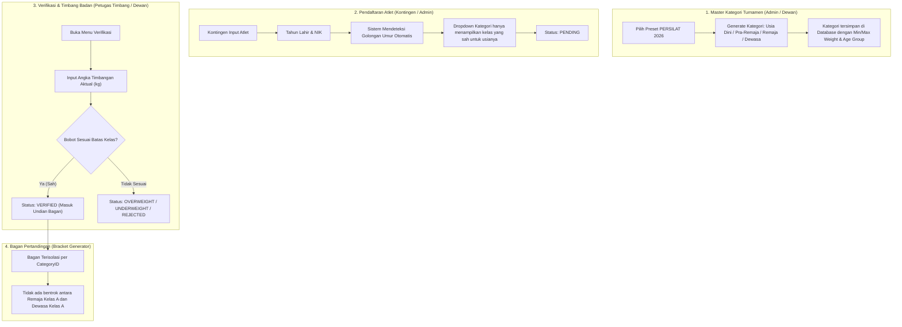

# 📋 Rencana Desain & Arsitektur: Kategori & Pendaftaran Resmi PERSILAT 2026

Rencana ini disusun mengacu langsung pada dokumen resmi terbaru:  
**"Pencak Silat International Competition Rules and Regulations 2026 (PERSILAT / IPSF - Revisi 25 Februari 2026)"** ([`rulesets/PENCAK-SILAT-COMPETITION-REGULATION-VER-FEB-2026-SIN03052026-R.pdf`](file:///d:/Freelance/DigitalScoring/rulesets/PENCAK-SILAT-COMPETITION-REGULATION-VER-FEB-2026-SIN03052026-R.pdf)).

---

## 1. Analisis Kebutuhan Berdasarkan Regulasi PERSILAT 2026

Berdasarkan **Pasal 1 & Pasal 2 (Hal 10–16)** dokumen resmi PERSILAT 2026:

### A. Penggolongan Umur Resmi (Pasal 2 Ayat 1c)
1. **Singa**: 3 – 6 tahun *(Pedoman selisih: umur max 1 th, tinggi max 3 cm, berat max 2 kg)*
2. **Macan**: 7 – 9 tahun *(Pedoman selisih: umur max 1 th, tinggi max 3 cm, berat max 2 kg)*
3. **Usia Dini (Pre-Teen)**: 10 – 11 tahun *(20 kelas putra & 20 kelas putri: Kelas A s/d S + OPEN)*
4. **Pra-Remaja (Pre-Junior)**: 12 – 13 tahun *(17 kelas putra & 17 kelas putri: Kelas A s/d P + OPEN)*
5. **Remaja (Junior)**: 14 – 16 tahun *(Putra: <39kg, A–L, OPEN 1 & 2; Putri: <39kg, A–J, OPEN 1 & 2)*
6. **Dewasa (Senior)**: 17 – 45 tahun *(Putra: <45kg, A–J, OPEN 1 & 2; Putri: <45kg, A–H, OPEN 1 & 2)*
7. **Master A**: 46 – 60 tahun *(Pedoman selisih berat badan: max 5 kg)*
8. **Master B**: 61 tahun ke atas *(Pedoman selisih berat badan: max 5 kg)*

> **Catatan Regulasi Umur:** Umur atlet dihitung berdasarkan **tahun kelahiran** (bukan tanggal hari-H) sesuai kartu identitas / paspor resmi.

---

### B. Matriks Kelas Berat Badan Tanding Resmi (Pasal 2 Ayat 3)

#### 1. Usia Dini (Pre-Teen: 10–11 Tahun)
- **Rentang Bobot**: 
  - Kelas A (26–28 kg), B (>28–30 kg), C (>30–32 kg), D (>32–34 kg), E (>34–36 kg)
  - Kelas F (>36–38 kg), G (>38–40 kg), H (>40–42 kg), I (>42–44 kg), J (>44–46 kg)
  - Kelas K (>46–48 kg), L (>48–50 kg), M (>50–52 kg), N (>52–54 kg), O (>54–56 kg)
  - Kelas P (>56–58 kg), Q (>58–60 kg), R (>60–62 kg), S (>62–64 kg)
  - **Kelas OPEN**: >64 kg s/d 68 kg

#### 2. Pra-Remaja (Pre-Junior: 12–13 Tahun)
- **Rentang Bobot**:
  - Kelas A (30–33 kg), B (>33–36 kg), C (>36–39 kg), D (>39–42 kg), E (>42–45 kg)
  - Kelas F (>45–48 kg), G (>48–51 kg), H (>51–54 kg), I (>54–57 kg), J (>57–60 kg)
  - Kelas K (>60–63 kg), L (>63–66 kg), M (>66–69 kg), N (>69–72 kg), O (>72–75 kg)
  - Kelas P (>75–78 kg)
  - **Kelas OPEN**: >78 kg s/d 84 kg

#### 3. Remaja (Junior: 14–16 Tahun)
- **Putra**: Under 39 kg, Kelas A (39–43 kg), B (>43–47 kg), C (>47–51 kg), D (>51–55 kg), E (>55–59 kg), F (>59–63 kg), G (>63–67 kg), H (>67–71 kg), I (>71–75 kg), J (>75–79 kg), K (>79–83 kg), L (>83–87 kg), **OPEN 1** (>87–100 kg), **OPEN 2** (>100 kg).
- **Putri**: Under 39 kg, Kelas A (39–43 kg), B (>43–47 kg), C (>47–51 kg), D (>51–55 kg), E (>55–59 kg), F (>59–63 kg), G (>63–67 kg), H (>67–71 kg), I (>71–75 kg), J (>75–79 kg), **OPEN 1** (>79–92 kg), **OPEN 2** (>92 kg).

#### 4. Dewasa (Senior: 17–45 Tahun)
- **Putra**: Under 45 kg, Kelas A (45–50 kg), B (>50–55 kg), C (>55–60 kg), D (>60–65 kg), E (>65–70 kg), F (>70–75 kg), G (>75–80 kg), H (>80–85 kg), I (>85–90 kg), J (>90–95 kg), **OPEN 1** (>95–110 kg), **OPEN 2** (>110 kg).
- **Putri**: Under 45 kg, Kelas A (45–50 kg), B (>50–55 kg), C (>55–60 kg), D (>60–65 kg), E (>65–70 kg), F (>70–75 kg), G (>75–80 kg), H (>80–85 kg), **OPEN 1** (>85–100 kg), **OPEN 2** (>100 kg).

---

### C. Ketentuan Timbang Badan Resmi (Pasal 1 Ayat 3, Hal 10–11)
- **Tidak ada toleransi berat badan**: Jika berat atlet di luar batas kelas (kurang/lebih), dikenakan sanksi **Diskualifikasi**.
- **Waktu Penimbangan**: Dilakukan di pagi hari sebelum pertandingan, hanya untuk pesilat yang dijadwalkan tanding pada hari tersebut (atau 2x penimbangan: hari ke-1 dan semifinal).
- **Pencatatan**: Petugas timbang dan ofisial tim menandatangani formulir resmi.

---

## 2. Alur Arsitektur Sistem Baru

---

## 3. Rencana Komponen yang Perlu Dibuat & Diperbarui

### A. Skema Database (PostgreSQL Migration)

1. **Tabel `categories`**:
   - `age_group VARCHAR(50) DEFAULT 'dewasa'` *(pilihan: `usia_dini`, `pra_remaja`, `remaja`, `dewasa`, `master_a`, `master_b`)*.
   - `min_weight NUMERIC(5,2)` *(bobot minimal kg)*.
   - `max_weight NUMERIC(5,2)` *(bobot maksimal kg)*.
2. **Tabel `athletes`**:
   - `birth_year INT` atau `birth_date DATE` *(untuk kalkulasi umur berbasis tahun kelahiran)*.
   - `nik VARCHAR(50)` *(Nomor Induk Kependudukan / Paspor)*.
3. **Tabel `participants`**:
   - `category_id UUID REFERENCES categories(id)` *(menghubungkan langsung atlet ke kategori spesifik)*.
   - `actual_weight NUMERIC(5,2)` *(hasil timbang badan aktual)*.
4. **Tabel `bracket_slots`**:
   - `category_id UUID REFERENCES categories(id)` *(memastikan bagan terisolasi per kategori)*.

---

### B. Backend Services (Go Core)

1. **`internal/domain/models.go`**:
   - Update model `Category`, `Athlete`, `Participant`, dan `BracketSlot`.
2. **`internal/store/`**:
   - Tambahkan pembacaan/penyimpanan kolom baru pada repository `category.go`, `athelete.go`, dan `bracket.go`.
3. **`internal/service/athlete_service.go` & `handler/athlete.go`**:
   - Validasi pendaftaran atlet terhadap umur minimum dan maksimum golongan.
   - Endpoint `VerifyParticipant` mencatat `actual_weight` dan memvalidasi apakah masuk di rentang min–max kelas.
4. **`internal/service/bracket_service.go` & `handler/bracket.go`**:
   - Mengelompokkan slot bagan berdasarkan `category_id` (bukan sekadar kode huruf kelas).

---

### C. Frontend Presets & UI (Vue / TypeScript)

1. **`category.schema.ts`**:
   - Masukkan preset lengkap tabel PERSILAT 2026:
     - 40 kelas Usia Dini (Putra & Putri A–S, OPEN)
     - 34 kelas Pra-Remaja (Putra & Putri A–P, OPEN)
     - 28 kelas Remaja (Putra <39, A–L, OPEN 1–2; Putri <39, A–J, OPEN 1–2)
     - 24 kelas Dewasa (Putra <45, A–J, OPEN 1–2; Putri <45, A–H, OPEN 1–2)
2. **`CategoryOpsView.vue`**:
   - Filter tab berdasarkan Golongan Umur: `Semua`, `Usia Dini`, `Pra-Remaja`, `Remaja`, `Dewasa`.
   - Tombol Batch Seed: Pengguna bisa memilih ingin men-generate preset golongan umur mana saja (misal hanya turnamen Remaja & Dewasa, atau semuanya).
3. **`AthletesOpsView.vue`**:
   - Form pendaftaran memiliki input Tahun Lahir / Tanggal Lahir & NIK.
   - Otomatis memfilter kelas yang muncul sesuai usia atlet.
4. **`ParticipantVerificationView.vue`**:
   - Tambahkan input **Hasil Timbang Badan (Kg)**.
   - Indikator badge otomatis:
     - 🟢 **SAH** (masuk rentang min-max kelas).
     - 🔴 **OVERWEIGHT / TIDAK SAH** (melebihi rentang kelas).
5. **`OpsShellView.vue` (Bagan Pertandingan)**:
   - Dropdown selektor bagan dikelompokkan dengan jelas:
     - `[Usia Dini Putra] - Kelas A`
     - `[Remaja Putra] - Kelas A`
     - `[Dewasa Putra] - Kelas A`

---

## 4. Keuntungan Penerapan Rencana Ini

1. **Sesuai Standar Internasional**: 100% patuh pada aturan resmi PERSILAT 2026.
2. **Mendukung Segala Skala Turnamen**: Baik turnamen khusus Dewasa (seperti POMNAS), turnamen Remaja (Popda/Kejurda), maupun Kejuaraan Terbuka (Open Tournament SD–Umum) dapat diakomodasi tanpa konflik data.
3. **Otomatisasi Meja Verifikasi**: Panitia timbang badan tidak perlu mengingat manual batas bobot tiap kelas; sistem langsung memberi tahu jika atlet kelebihan bobot.
4. **Keamanan Bagan**: Tidak akan ada atlet beda jenjang umur yang salah terundi ke bagan yang sama.
